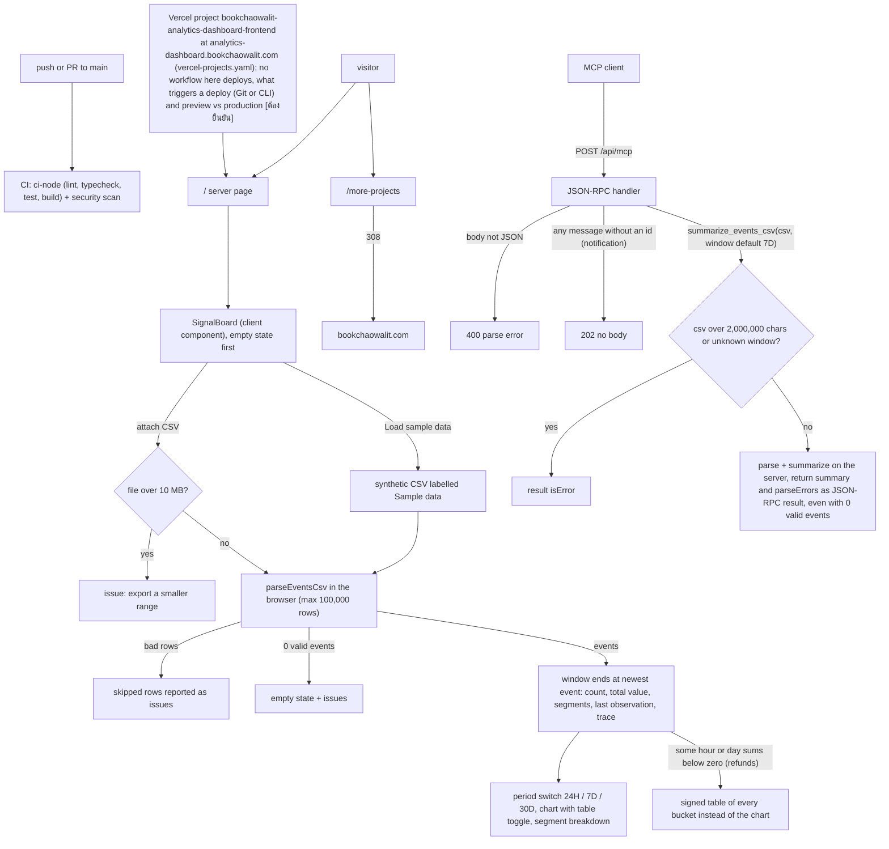
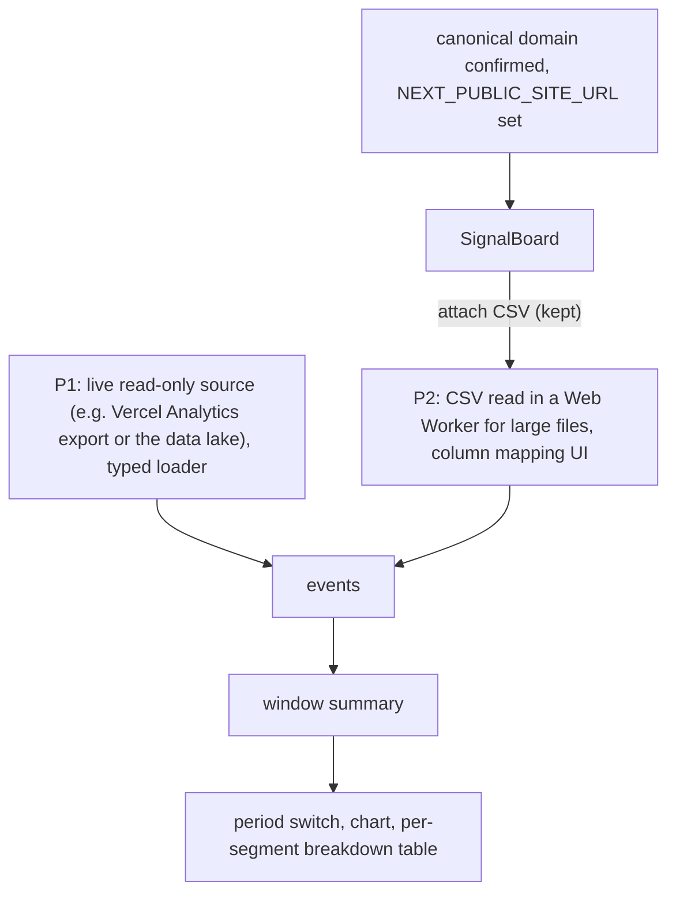

# 01 — Business process (As-Is / To-Be)

data-analytics-dashboard-web ("Signal Ledger") คือหน้า dashboard ที่อ่านไฟล์ CSV ของ event ในเบราว์เซอร์แล้วสรุปตามช่วง 24H / 7D / 30D โดยไม่อัปโหลดไฟล์ไปที่ไหน ถ้าไม่มีไฟล์จะแสดง empty state (ไม่มีตัวเลขหลอก) และมีปุ่มโหลดข้อมูลตัวอย่างที่ติดป้าย Sample data; มี `/api/mcp` สรุป CSV แบบ stateless ให้ agent

Last reviewed: 2026-11-28 · commit `83d05a4`

## As-Is (จากโค้ดวันนี้)

Sources: `app/page.tsx`, `components/signal-board.tsx`, `lib/analytics.ts`, `lib/mcp.ts`, `app/api/mcp/route.ts`, `lib/site.ts`, `app/robots.ts`, `app/sitemap.ts`, `app/opengraph-image.tsx`, `next.config.ts`, `.github/workflows/ci.yml`, `README.md`, `docs/UPGRADE-PLAN.md`, `repository-catalog/registries/vercel-projects.yaml` (bookchaowalit-empire)

ข้อเท็จจริงสำคัญจากโค้ด:

- ข้อมูลอยู่ใน memory ของหน้าเท่านั้น ไม่มี database, ไม่มี live data source, ไม่มีการอัปโหลดจากหน้าเว็บ; MCP tool ไม่เก็บ CSV
- ข้อความ "CSV ไม่ออกจากเบราว์เซอร์" ใช้กับหน้าเว็บเท่านั้น: `/api/mcp` รับข้อความ CSV มา parse และสรุปบนเซิร์ฟเวอร์ แล้วคืนผลใน JSON-RPC (`app/api/mcp/route.ts`, `lib/mcp.ts`) ไม่เก็บ CSV
- เมื่อยอดรวมของช่วงย่อย (ชั่วโมงหรือวัน) ใดติดลบ เช่นรายการคืนเงิน หน้าแสดงตารางค่าบวก/ลบของทุกช่วงแทนกราฟ (`components/signal-board.tsx`) ไม่ใช่ข้อผิดพลาด
- CSV ต้องมีคอลัมน์ `timestamp` (ISO 8601 หรือ epoch 10 หลัก = วินาที, 11–13 หลัก = มิลลิวินาที; epoch 9 หลักหรือสั้นกว่าถูกข้ามเป็น invalid timestamp ควรใช้ ISO 8601 กับข้อมูลเก่ากว่านั้น; date-time ไม่มี offset อ่านเป็น UTC) และมี `segment`, `value` เป็นทางเลือก (value default 1)
- ช่วงเวลานับถอยหลังจาก event ใหม่สุดในไฟล์ จึงใช้กับ export ย้อนหลังได้
- `SITE_URL` มาจาก `NEXT_PUBLIC_SITE_URL` หรือ default `https://analytics-dashboard.bookchaowalit.com`; `robots.ts` ห้าม `/api/`
- ทะเบียน `bookchaowalit-empire/repository-catalog/registries/vercel-projects.yaml` ระบุ Vercel project `bookchaowalit-analytics-dashboard-frontend` และ URL `https://analytics-dashboard.bookchaowalit.com`; ตัวกระตุ้น deploy (Git หรือ CLI) และสถานะ production จริงไม่อยู่ใน repo [ต้องยืนยัน]; CI ไม่ได้ deploy

## To-Be (จาก docs/UPGRADE-PLAN.md)

Sources: `docs/UPGRADE-PLAN.md` (Backlog P1, P2)

## Gap

| ID | As-Is → To-Be | Status | Owner | Evidence |
|---|---|---|---|---|
| G1 | local CSV only → a live read-only source with a typed loader (keep the CSV path) | decide | owner | `docs/UPGRADE-PLAN.md` P1 |
| G2 | default `SITE_URL` in code → canonical domain confirmed and `NEXT_PUBLIC_SITE_URL` set | todo | owner | `docs/UPGRADE-PLAN.md` P1 |
| G3 | CSV parsed on the main thread, fixed column names → Web Worker parsing and a column mapping UI | todo | claude | `docs/UPGRADE-PLAN.md` P2 |

## Open questions

- `docs/UPGRADE-PLAN.md` P2 ขอ "per-segment breakdown table" แต่ `components/signal-board.tsx` มีรายการ segment (`segmentBreakdown`) อยู่แล้ว ส่วนนี้อาจเสร็จไปแล้ว [ต้องยืนยัน]
